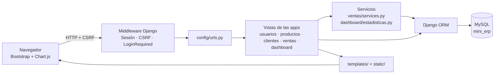
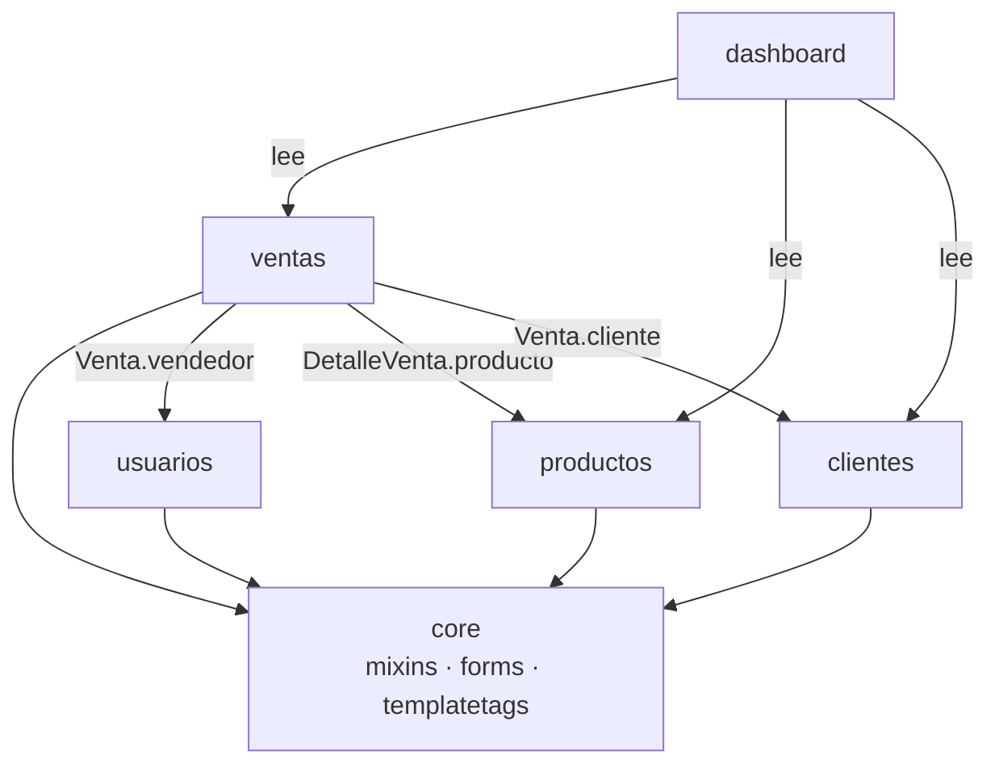
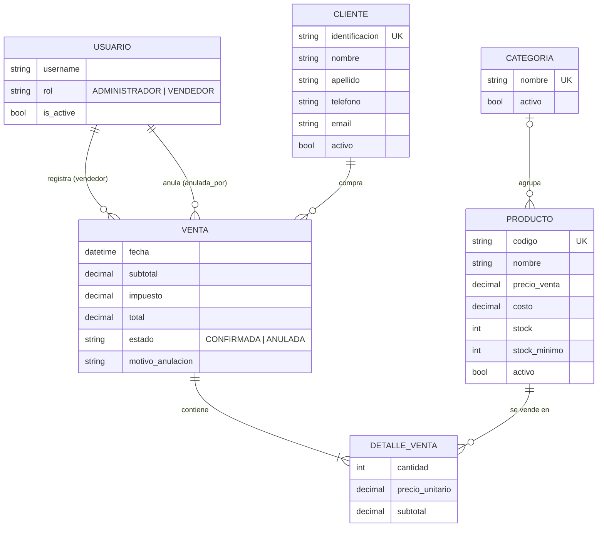
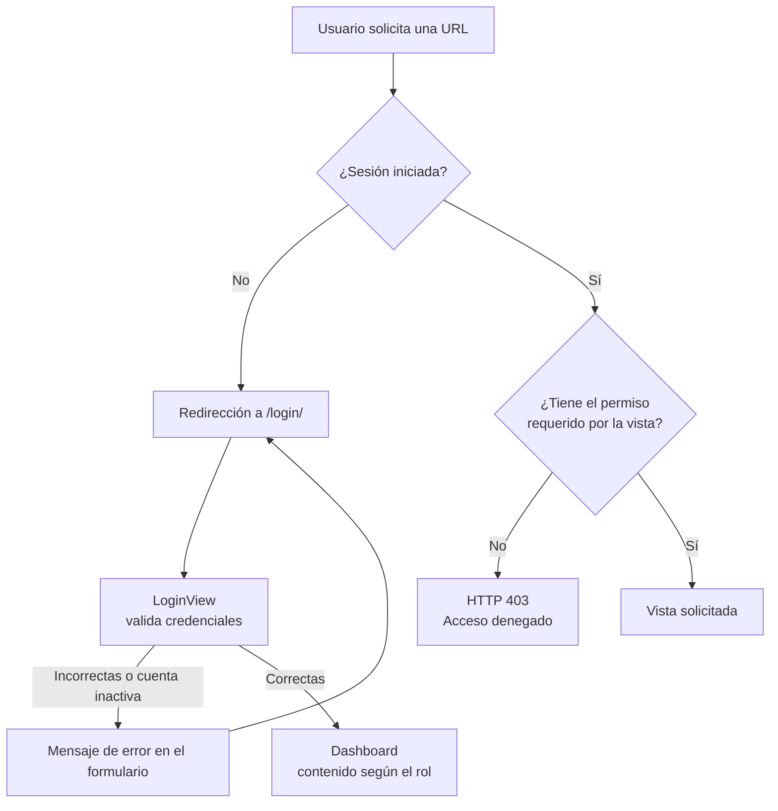
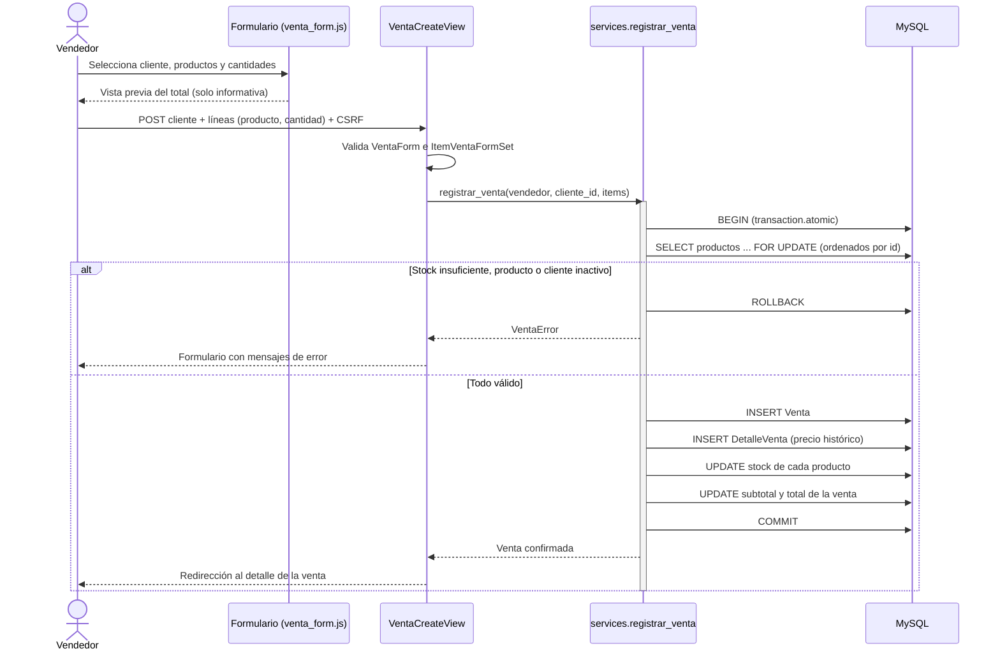
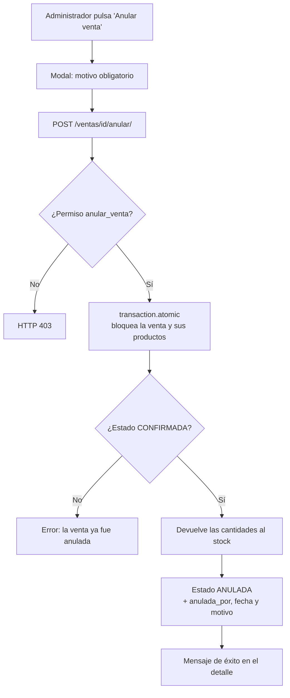

<p align="center">
  
</p>

<h1 align="center">MINI ERP</h1>

<p align="center">
  Sistema de gestión empresarial · Inventario · Clientes · Ventas · Analítica
</p>

<p align="center">
  
  
  
  
  
</p>

<p align="center">
  <a href="#-presentación">Presentación</a> ·
  <a href="#-características">Características</a> ·
  <a href="#-instalación">Instalación</a> ·
  <a href="#-autenticación-y-permisos">Permisos</a> ·
  <a href="#-flujo-de-ventas">Flujo de ventas</a> ·
  <a href="#-pruebas">Pruebas</a>
</p>

---

## Tabla de contenidos

1. [Presentación](#-presentación)
2. [Características](#-características)
3. [Tecnologías](#-tecnologías)
4. [Arquitectura](#-arquitectura)
5. [Diagramas de arquitectura](#-diagramas-de-arquitectura)
6. [Estructura del proyecto](#-estructura-del-proyecto)
7. [Requisitos previos](#-requisitos-previos)
8. [Instalación](#-instalación)
9. [Variables de entorno](#-variables-de-entorno)
10. [Configuración de MySQL](#-configuración-de-mysql)
11. [Migraciones](#-migraciones)
12. [Ejecución](#-ejecución)
13. [Autenticación y permisos](#-autenticación-y-permisos)
14. [Módulos del sistema](#-módulos-del-sistema)
15. [Flujo de ventas](#-flujo-de-ventas)
16. [Capturas de pantalla](#-capturas-de-pantalla)
17. [Pruebas](#-pruebas)
18. [Solución de problemas](#-solución-de-problemas)
19. [Próximas mejoras](#-próximas-mejoras)
20. [Autor y licencia](#-autor-y-licencia)

---

## 🚀 Presentación

**MINI ERP** es una aplicación web desarrollada con **Django** y **MySQL** para gestionar las operaciones básicas de un pequeño negocio:

- control de **inventario** de productos y categorías,
- administración de **clientes**,
- registro de **ventas** con descuento automático de stock,
- **dashboard** con indicadores y gráficos,
- **usuarios** con dos roles: Administrador y Vendedor.

La lógica de negocio sensible (cálculo de importes, control de stock y anulaciones) se ejecuta en el servidor, dentro de transacciones de base de datos.

---

## ✨ Características

| Área | Funcionalidades implementadas |
|---|---|
| Autenticación | Login y logout, sesión obligatoria en todas las rutas, sesión de 8 horas que expira al cerrar el navegador |
| Usuarios y roles | CRUD de usuarios, cambio de contraseña por el administrador, activar/desactivar, roles basados en grupos y permisos nativos de Django |
| Productos | Registro, listado, detalle, edición, desactivación, búsqueda por código o nombre, filtros (categoría, estado, stock bajo/agotado), ordenamiento, paginación |
| Categorías | Registro, listado con número de productos y edición |
| Inventario | Stock actual y mínimo, alertas de stock bajo, restricciones que impiden valores negativos |
| Clientes | Registro, listado, detalle con historial de ventas, edición, desactivación, búsqueda por identificación, nombre o teléfono |
| Ventas | Venta con varios productos, cálculo en backend, precio histórico, control de concurrencia, anulación con restauración de inventario, filtros por fecha, estado y vendedor |
| Dashboard | KPIs, ventas de los últimos 30 días y 12 meses, top 5 de productos, ventas recientes, stock bajo, vista distinta por rol |
| Interfaz | Sidebar, barra superior, tarjetas, tablas, modales de confirmación, alertas, diseño responsive, páginas 403 y 404 |

---

## 🛠 Tecnologías

<p align="center">
  <a href="https://skillicons.dev">
    
  </a>
</p>

| Capa | Tecnología | Uso en el proyecto |
|---|---|---|
| Lenguaje | Python 3.14 | Backend |
| Framework | Django 5.2.19 (LTS) | ORM, autenticación, permisos, plantillas, formularios |
| Base de datos | MySQL 8.0 | Motor de producción (`django.db.backends.mysql`) |
| Conector | `mysqlclient` 2.3.1 | Driver MySQL para Django |
| Configuración | `python-dotenv` 1.2.4 | Lectura del archivo `.env` |
| Frontend | HTML5, CSS3, JavaScript | Plantillas Django, `static/css/app.css`, `static/js/` |
| UI | Bootstrap 5.3.3 y Bootstrap Icons 1.11.3 (CDN) | Maquetación responsive e iconografía |
| Gráficos | Chart.js 4.4.4 (CDN) | Gráficos del dashboard |
| Pruebas | `django.test` + SQLite en memoria | Suite de pruebas sin dependencia de MySQL |

> Las dependencias de Python están fijadas en [`requirements.txt`](requirements.txt).

---

## 🏗 Arquitectura

El proyecto sigue la arquitectura **MVT de Django**, con una aplicación por módulo y una capa de servicios para la lógica de ventas.

| Aplicación | Responsabilidad |
|---|---|
| `config` | Configuración global (`settings.py`), URLs raíz, `settings_test.py` para pruebas |
| `core` | Utilidades compartidas: mixins de permisos y ordenamiento, formulario base Bootstrap, filtros de plantilla (`moneda`, ordenamiento), helpers de pruebas |
| `usuarios` | Modelo `Usuario` personalizado (`AUTH_USER_MODEL`), roles → grupos, login/logout, gestión de usuarios |
| `productos` | Modelos `Categoria` y `Producto`, CRUD y consultas de inventario |
| `clientes` | Modelo `Cliente` y su CRUD |
| `ventas` | Modelos `Venta` y `DetalleVenta`; `services.py` con el registro y la anulación transaccional |
| `dashboard` | Vista del panel y cálculo de indicadores (`estadisticas.py`) |

Principios aplicados:

- **Vistas basadas en clases** con `PermissionRequiredMixin` y control de visibilidad por usuario.
- **Lógica de negocio fuera de las vistas**: `ventas/services.py` y `dashboard/estadisticas.py`.
- **Validación en dos niveles**: formularios Django y restricciones `CHECK` / `UNIQUE` en la base de datos.
- **Plantillas reutilizables** en `templates/includes/` (sidebar, topbar, mensajes, paginación, modal de confirmación, campos de formulario).

---

## 🧭 Diagramas de arquitectura

### Vista general



### Relación entre aplicaciones



### Modelo de datos



Las relaciones hacia `Usuario`, `Cliente`, `Producto` y `Categoria` usan `on_delete=PROTECT`: no se puede borrar un registro que tenga ventas o productos asociados. Por eso los registros se **desactivan**, no se eliminan.

### Flujo de autenticación



---

## 📁 Estructura del proyecto

```
mini-ERP/
├── banner.jpg                 # Banner del README
├── manage.py
├── requirements.txt
├── .env.example               # Plantilla de variables de entorno
├── config/
│   ├── settings.py            # Configuración principal (lee .env, MySQL)
│   ├── settings_test.py       # Pruebas con SQLite en memoria
│   ├── urls.py                # Rutas raíz
│   ├── asgi.py
│   └── wsgi.py
├── core/
│   ├── forms.py               # BootstrapFormMixin
│   ├── mixins.py              # PermisoRequeridoMixin, FiltroOrdenMixin
│   ├── testing.py             # Fábricas de datos para pruebas
│   └── templatetags/erp.py    # Filtros moneda, decimal_js y etiquetas de orden
├── usuarios/                  # models, roles.py, signals.py, forms, views, urls, admin, tests
├── productos/                 # models, forms, views, urls, admin, tests
├── clientes/                  # models, forms, views, urls, admin, tests
├── ventas/                    # models, services.py, forms, views, urls, admin, tests
├── dashboard/                 # estadisticas.py, views, urls, tests
├── templates/
│   ├── base.html
│   ├── 403.html · 404.html
│   ├── includes/              # sidebar, topbar, messages, pagination, confirm_modal,
│   │                          # form_fields, th_orden, estado_badge
│   ├── registration/login.html
│   ├── dashboard/             # inicio.html, _stat.html
│   ├── usuarios/              # lista, form, password
│   ├── productos/             # lista, detalle, form, categorias, categoria_form
│   ├── clientes/              # lista, detalle, form
│   └── ventas/                # lista, detalle, form, _item_row, _estado
└── static/
    ├── css/app.css
    ├── js/app.js              # Modal de confirmación y prevención de doble envío
    ├── js/venta_form.js       # Líneas dinámicas y vista previa de la venta
    └── img/logo.svg           # Favicon y logo del login
```

Cada aplicación incluye su carpeta `migrations/` con la migración inicial ya generada.

---

## 📋 Requisitos previos

| Herramienta | Versión | Notas |
|---|---|---|
| Python | 3.14 (versión usada en desarrollo) | Django 5.2 admite Python 3.10 a 3.14 |
| MySQL Server | 8.0.11 o superior | Probado con MySQL 8.0.46 |
| pip | Incluido con Python | |
| MySQL Workbench o cliente `mysql` | Opcional | Para crear la base de datos |
| Git | Opcional | Para clonar el repositorio |

> **Importante:** el proyecto usa Django 5.2 LTS. Django 6.x exige MySQL 8.4 o superior y no funciona con MySQL 8.0.

---

## 💻 Instalación

Instrucciones para **Windows** (PowerShell), desde la carpeta del proyecto.

**1. Crear y activar el entorno virtual**

```powershell
python -m venv .venv
.venv\Scripts\activate
```

**2. Instalar las dependencias**

```powershell
pip install -r requirements.txt
```

**3. Crear el archivo `.env`**

```powershell
copy .env.example .env
```

Completa los valores como se explica en [Variables de entorno](#-variables-de-entorno).

---

## 🔐 Variables de entorno

`config/settings.py` carga el archivo `.env` con `python-dotenv`. Este archivo **no se versiona** (está en `.gitignore`); usa [`.env.example`](.env.example) como plantilla.

| Variable | Obligatoria | Valor por defecto | Descripción |
|---|:---:|---|---|
| `SECRET_KEY` | Sí | — | Clave secreta de Django |
| `DEBUG` | No | `False` | `True` solo en desarrollo |
| `ALLOWED_HOSTS` | No | `127.0.0.1,localhost` | Hosts permitidos, separados por coma |
| `TIME_ZONE` | No | `America/Bogota` | Zona horaria usada en fechas y estadísticas |
| `DB_NAME` | Sí | — | Nombre de la base de datos |
| `DB_USER` | Sí | — | Usuario de MySQL |
| `DB_PASSWORD` | No | vacío | Contraseña del usuario de MySQL |
| `DB_HOST` | No | `127.0.0.1` | Servidor MySQL |
| `DB_PORT` | No | `3306` | Puerto de MySQL |

Ejemplo, con valores ficticios:

```ini
SECRET_KEY=cambia-esta-clave
DEBUG=True
ALLOWED_HOSTS=127.0.0.1,localhost
TIME_ZONE=America/Bogota

DB_NAME=mini_erp
DB_USER=erp_user
DB_PASSWORD=tu-contraseña
DB_HOST=127.0.0.1
DB_PORT=3306
```

Para generar una `SECRET_KEY`:

```powershell
python -c "from django.core.management.utils import get_random_secret_key as g; print(g())"
```

Si falta una variable obligatoria, Django se detiene con el mensaje `Falta la variable de entorno ...`.

Con `DEBUG=False` se activan las cookies seguras de sesión y CSRF, que requieren HTTPS.

---

## 🐬 Configuración de MySQL

La conexión usa el juego de caracteres `utf8mb4`, el modo estricto `STRICT_TRANS_TABLES` y el nivel de aislamiento `READ COMMITTED`.

**1. Crear la base de datos** (MySQL Workbench o `mysql -u root -p`):

```sql
CREATE DATABASE mini_erp CHARACTER SET utf8mb4 COLLATE utf8mb4_unicode_ci;
```

**2. (Recomendado) Crear un usuario exclusivo para la aplicación:**

```sql
CREATE USER 'erp_user'@'localhost' IDENTIFIED BY 'una-contraseña-segura';
GRANT ALL PRIVILEGES ON mini_erp.* TO 'erp_user'@'localhost';
-- Necesario para ejecutar las pruebas sobre MySQL:
GRANT ALL PRIVILEGES ON test_mini_erp.* TO 'erp_user'@'localhost';
FLUSH PRIVILEGES;
```

**3. Indicar las credenciales** en `DB_NAME`, `DB_USER` y `DB_PASSWORD` dentro de `.env`.

---

## 🔄 Migraciones

Las migraciones iniciales de `usuarios`, `productos`, `clientes` y `ventas` ya están incluidas en el repositorio. Para aplicarlas:

```powershell
python manage.py migrate
```

Al terminar, una señal `post_migrate` crea o actualiza automáticamente los grupos **Administrador** y **Vendedor** con sus permisos (`usuarios/roles.py`).

Si modificas los modelos, genera nuevas migraciones y aplícalas:

```powershell
python manage.py makemigrations
python manage.py migrate
```

---

## 🏁 Ejecución

**1. Crear el administrador inicial**

```powershell
python manage.py createsuperuser
```

El superusuario recibe automáticamente el rol **Administrador**. El resto de usuarios se crea desde la aplicación, en **Administración → Usuarios**.

**2. Iniciar el servidor de desarrollo**

```powershell
python manage.py runserver
```

**3. Abrir el navegador**

| URL | Descripción |
|---|---|
| http://127.0.0.1:8000/ | Dashboard (redirige al login si no hay sesión) |
| http://127.0.0.1:8000/login/ | Inicio de sesión |
| http://127.0.0.1:8000/admin/ | Administrador de Django (en él las ventas son de solo lectura) |

---

## 🛡 Autenticación y permisos

- **Modelo de usuario personalizado:** `usuarios.Usuario` hereda de `AbstractUser` y añade el campo `rol`.
- **Sesión obligatoria:** `LoginRequiredMiddleware` protege todas las rutas, excepto el login.
- **Roles como grupos:** al guardar un usuario, una señal `post_save` lo asigna al grupo de su rol.
- **Control por permiso:** las vistas comprueban permisos de Django y no el nombre del rol. Un usuario sin permiso recibe **HTTP 403** aunque escriba la URL a mano.
- **Acciones solo por POST con CSRF:** activar o desactivar registros, anular ventas y cerrar sesión.
- **Restricciones adicionales:** un administrador no puede desactivarse ni cambiarse el rol a sí mismo, y un superusuario siempre tiene rol Administrador.

| Función | Administrador | Vendedor |
|---|:---:|:---:|
| Gestión de usuarios (crear, editar, contraseña, activar/desactivar) | ✅ | ❌ |
| Crear, editar o desactivar productos y categorías | ✅ | ❌ |
| Consultar productos | ✅ Todos, con costo | ✅ Solo activos, sin costo |
| Crear, editar o desactivar clientes | ✅ | ❌ |
| Consultar clientes | ✅ Todos | ✅ Solo activos |
| Registrar ventas | ✅ | ✅ |
| Consultar ventas | ✅ Todas | ✅ Solo las propias |
| Anular ventas | ✅ Con motivo obligatorio | ❌ |
| Dashboard | Estadísticas generales | Solo sus ventas |

<details>
<summary>Permisos asignados a cada grupo</summary>

**Administrador**

- `usuarios`: `view_usuario`, `add_usuario`, `change_usuario`
- `productos`: `view_producto`, `add_producto`, `change_producto`, `view_categoria`, `add_categoria`, `change_categoria`, `ver_costos`
- `clientes`: `view_cliente`, `add_cliente`, `change_cliente`
- `ventas`: `view_venta`, `add_venta`, `anular_venta`, `ver_todas_ventas`, `ver_estadisticas_generales`

**Vendedor**

- `productos.view_producto`, `clientes.view_cliente`, `ventas.view_venta`, `ventas.add_venta`

</details>

---

## 🧩 Módulos del sistema

### 👤 Usuarios — `/usuarios/`

| Ruta | Función |
|---|---|
| `/usuarios/` | Listado con búsqueda por usuario, nombre o correo; filtros por rol y estado; ordenamiento |
| `/usuarios/nuevo/` | Alta con contraseña validada por los validadores de Django |
| `/usuarios/<id>/editar/` | Edición de datos, rol y estado |
| `/usuarios/<id>/password/` | Cambio de contraseña por el administrador |
| `/usuarios/<id>/estado/` | Activar o desactivar (POST) |

### 📦 Productos — `/productos/`

| Ruta | Función |
|---|---|
| `/productos/` | Listado con búsqueda, filtros (categoría, estado, stock bajo/agotado), orden y aviso de stock bajo |
| `/productos/nuevo/` | Registro |
| `/productos/<id>/` | Detalle con inventario y, para el administrador, últimas ventas del producto |
| `/productos/<id>/editar/` | Edición |
| `/productos/<id>/estado/` | Activar o desactivar (POST) |
| `/productos/categorias/` | Listado de categorías, alta (`nueva/`) y edición (`<id>/editar/`) |

Reglas:

- El código es único y se normaliza a mayúsculas.
- Precio, costo, stock y stock mínimo no admiten valores negativos.
- Un producto está en **stock bajo** cuando `stock <= stock_minimo`.

### 🧑‍💼 Clientes — `/clientes/`

| Ruta | Función |
|---|---|
| `/clientes/` | Listado con búsqueda por identificación, nombre, apellido o teléfono |
| `/clientes/nuevo/` | Registro |
| `/clientes/<id>/` | Detalle con sus últimas ventas (el vendedor ve solo las propias) |
| `/clientes/<id>/editar/` | Edición |
| `/clientes/<id>/estado/` | Activar o desactivar (POST) |

Validaciones:

- La identificación es única, de 5 a 20 caracteres alfanuméricos o guion.
- El teléfono admite de 7 a 20 caracteres entre dígitos, `+`, espacios, guiones y paréntesis.
- El correo se valida y se guarda en minúsculas.

### 🧾 Ventas — `/ventas/`

| Ruta | Función |
|---|---|
| `/ventas/` | Listado con búsqueda (número de venta o cliente), filtros por fechas, estado y vendedor, y total confirmado del filtro |
| `/ventas/nueva/` | Registro de venta con varias líneas de producto |
| `/ventas/<id>/` | Detalle imprimible con cliente, vendedor, líneas y totales |
| `/ventas/<id>/anular/` | Anulación con motivo (POST, solo administrador) |

Reglas de negocio (`ventas/services.py`):

- Los precios, subtotales y total se calculan en el **backend**; se ignora cualquier importe enviado por el navegador.
- No se puede vender más que el stock disponible, ni productos o clientes inactivos, ni cantidades menores que 1.
- Las líneas repetidas del mismo producto se consolidan.
- El precio unitario queda congelado en `DetalleVenta` (**precio histórico**).
- Las ventas confirmadas no se pueden editar ni eliminar.
- La anulación restaura el inventario y registra quién anuló, cuándo y por qué.
- No se aplica impuesto: `total = subtotal`. El campo `impuesto` existe con valor 0.
- Los importes usan `DecimalField` con redondeo `ROUND_HALF_UP` a 2 decimales.

### 📊 Dashboard — `/`

| Vista de Administrador | Vista de Vendedor |
|---|---|
| Productos y clientes activos | Sus ventas de hoy e ingresos del mes |
| Ventas confirmadas e ingresos acumulados | Sus ventas confirmadas e ingresos acumulados |
| Gráfico de ventas (30 días / 12 meses) | Gráfico de sus ventas (30 días / 12 meses) |
| Top 5 productos más vendidos | Productos disponibles, clientes activos, sus ventas anuladas |
| Ventas recientes y productos con stock bajo | Sus ventas recientes |

Las ventas anuladas no se suman en los ingresos. La agrupación por día y mes se calcula en Python con la zona horaria local, para no depender de las tablas de zonas horarias de MySQL.

---

## 🔁 Flujo de ventas

### Registro de una venta



Si dos vendedores intentan vender a la vez las últimas unidades, el bloqueo `SELECT ... FOR UPDATE` obliga al segundo a esperar. Cuando el primero termina, el segundo vuelve a validar el stock ya actualizado. Una prueba automática verifica este caso.

### Anulación de una venta



---

## 🖼 Capturas de pantalla

> Sección pendiente: el repositorio todavía no incluye capturas. Se sugiere guardarlas en una carpeta como `docs/capturas/` y enlazarlas aquí.

| Pantalla | Captura |
|---|---|
| Inicio de sesión | _Pendiente_ |
| Dashboard (Administrador) | _Pendiente_ |
| Dashboard (Vendedor) | _Pendiente_ |
| Listado de productos | _Pendiente_ |
| Nueva venta | _Pendiente_ |
| Detalle de venta | _Pendiente_ |

---

## 🧪 Pruebas

El proyecto incluye **50 pruebas** automatizadas:

| App | Pruebas | Qué cubren |
|---|:---:|---|
| `usuarios` | 14 | Login, logout, cuentas inactivas, grupos y permisos, bloqueo de URLs para el vendedor, gestión de usuarios |
| `productos` | 11 | Código único, valores negativos, stock bajo, búsqueda, orden, visibilidad para el vendedor |
| `clientes` | 6 | Identificación única, formatos, búsqueda, permisos |
| `ventas` | 17 | Totales, consolidación, stock insuficiente, precio histórico, anulación, visibilidad, concurrencia |
| `dashboard` | 2 | Estadísticas generales y por vendedor |

**Sin MySQL** (SQLite en memoria, no requiere credenciales):

```powershell
python manage.py test --settings=config.settings_test
```

En este modo se omite la prueba de concurrencia, porque depende de `SELECT ... FOR UPDATE` en MySQL.

**Con MySQL** (requiere `.env` configurado; Django crea y elimina la base temporal `test_mini_erp`):

```powershell
python manage.py test
```

---

## 🩺 Solución de problemas

| Error | Causa | Solución |
|---|---|---|
| `Access denied for user ... (using password: NO)` | `DB_PASSWORD` vacío en `.env` | Escribir la contraseña y guardar el archivo |
| `Access denied for user ... (using password: YES)` | Usuario o contraseña incorrectos | Comprobarlos en MySQL Workbench |
| `Unknown database 'mini_erp'` | La base de datos no existe | Ver [Configuración de MySQL](#-configuración-de-mysql) |
| `Table ... doesn't exist` | Migraciones sin aplicar | Ejecutar `python manage.py migrate` |
| `MySQL 8.4 or later is required` | Django 6.x instalado con MySQL 8.0 | Instalar las versiones de `requirements.txt` (Django 5.2) |
| `Falta la variable de entorno ...` | `.env` inexistente o incompleto | Ver [Variables de entorno](#-variables-de-entorno) |

---

## 🗺 Próximas mejoras

Propuestas a partir del estado actual del código. **Ninguna está implementada.**

- [ ] Impuesto configurable: el campo `Venta.impuesto` existe, pero hoy siempre vale 0.
- [ ] Cambio de contraseña por el propio usuario: hoy solo puede cambiarla un administrador.
- [ ] Recuperación de contraseña por correo: el envío de correo está configurado solo en modo consola.
- [ ] Exportación de reportes de ventas e inventario (CSV o PDF).
- [ ] Registro rápido de un cliente desde el formulario de venta, sin salir de la página.
- [ ] Capturas de pantalla en este README.

---

## 👥 Autor y licencia

| | |
|---|---|
| **Autor** | _Pendiente de definir_ |
| **Licencia** | _Pendiente de definir_: el repositorio todavía no incluye un archivo `LICENSE` |

<p align="center">
  <sub>MINI ERP · Django + MySQL</sub>
</p>
